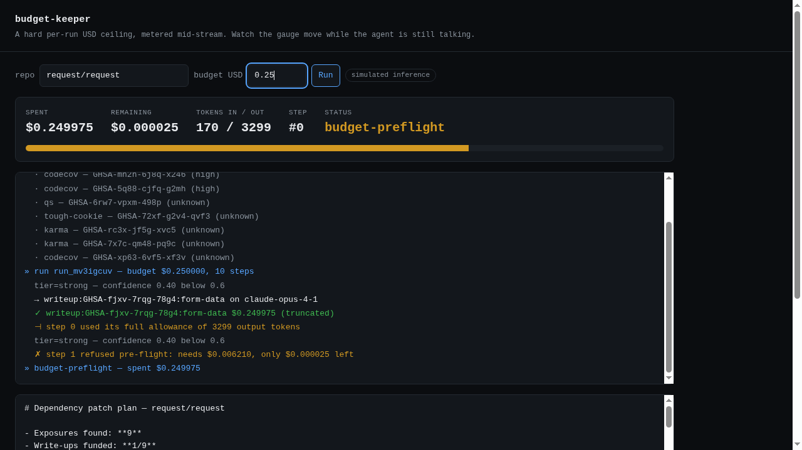

# budget-keeper

A multi-step agent that **cannot** exceed a USD budget you give it, and a dashboard that
shows the money being spent while the model is still talking.

Most "cost control" in agent systems is accounting: run the thing, add up the usage, report
what it cost. That tells you about the past. This project treats the budget as a **constraint
the agent runs inside** — the governor computes how many output tokens the remaining money
can actually buy, hands that number to the provider as `max_tokens`, meters spend on every
streamed chunk, and refuses to start a step it cannot afford to finish. When the money runs
out it returns the work it already paid for instead of raising.



The task it governs is real and independently checkable: scan a GitHub repository's
`package.json`, cross-reference every dependency against GitHub's Advisory Database, and draft
a prioritised dependency patch plan. The task is deliberately boring. The governor is the
project.

---

## The three mechanisms, and why each exists

A budget enforced in only one place is not enforced.

### 1. The affordable output allowance — the load-bearing one

Before each step, the governor solves for how many output tokens the *remaining* budget can
buy at the chosen model's prices, given the measured prompt:

```
affordable = floor((remainingUSD - inputCost) / pricePerOutputToken)
```

That number is passed to the provider as `max_tokens`. The step's worst case is therefore
equal to the money left, **by construction** — not by hope. This is what makes the ceiling
hard. A budget that can only afford a short answer gets a short answer, rather than a refusal.

### 2. Pre-flight refusal

If the affordable allowance falls below a floor (default 48 output tokens), the step never
starts. Paying a prompt's input cost to receive a dozen words is spending real money on
nothing useful; the governor keeps the remainder for the report instead and records the step
as unfunded.

### 3. The mid-stream kill-switch

While a stream is open, the ledger updates on every chunk and is tested against both the
granted allowance and the dollar budget. On breach the stream's `AbortSignal` fires and the
partial text is kept.

With mechanism 1 in place, this is **unreachable for any provider that honours `max_tokens`**.
It is the defence against one that does not — see the honest limits below.

---

## Architecture

```mermaid
flowchart TB
    subgraph Task["Task layer — no cost logic, no LLM calls"]
        A["package.json<br/>via GitHub Contents API"] --> C
        B["GitHub Advisory DB<br/>/advisories?ecosystem=npm"] --> C
        C["isExposed()<br/>semver range match"] --> D["prioritise()<br/>severity → runtime → range-bump"]
        D --> E["buildSteps()<br/>1 step per exposure + roll-up"]
    end

    subgraph Gov["Governor — the project"]
        E --> F{"chooseTier()<br/>confidence / size / retry"}
        F --> G["affordableOutputTokens()<br/>what can remaining $ buy?"]
        G --> H{"allowance ≥ floor?"}
        H -- no --> I["preflight-refusal<br/>step never starts, $0 spent"]
        H -- yes --> J["stream with max_tokens = allowance"]
        J --> K["Ledger.observe()<br/>per chunk, live USD"]
        K --> L{"over allowance<br/>or over budget?"}
        L -- yes --> M["abort stream<br/>keep partial text"]
        L -- no --> K
        M --> N["fold partial into state"]
        K --> N
    end

    subgraph Out["Always returns, never throws"]
        N --> O["RunResult<br/>steps · skipped · overshootUsd · partial"]
        O --> P["markdown patch plan<br/>unfunded items labelled"]
        O --> Q["SSE event stream → live dashboard"]
    end

    style Gov fill:#13171c,stroke:#58a6ff
    style I fill:#3d2b14,stroke:#d29922
    style M fill:#3d1d1d,stroke:#f85149
```



The task layer contains no cost logic and makes no model calls; the governor knows nothing
about advisories. That separation is why the governor can be property-tested without the task
and the task verified without a model.

---

## Tier routing

Steps declare a default tier; the router escalates or de-escalates from observed signals, and
always returns a reason — a routing decision nobody can explain after the fact is
indistinguishable from a bug.

| Signal | Effect | Why |
|---|---|---|
| Retry of a failed tier | escalate one tier | retrying the tier that just failed is the most common way an agent burns budget for nothing |
| Input > 24k chars | escalate one tier | long-context is where cheap models degrade most, and the input is already paid for |
| Confidence < 0.6 | escalate one tier | low confidence predicts a redo, which costs more than going up once |
| Confidence ≥ 0.85 | de-escalate one tier | mechanical work does not need a frontier model |

For the patch-plan task these are derived from the advisory itself: a critical advisory whose
fix needs a semver-range bump goes to the strongest tier (a human will act on it, possibly out
of hours); a low-severity drop-in version bump is handed to the cheap tier at 0.9 confidence.

---

## Run it

No credentials required. With no `ANTHROPIC_API_KEY`, a deterministic simulator stands in for
the model and every surface labels itself `simulated inference`, because a cost figure from a
simulator must never be presentable as a real spend.

```bash
npm install

# CLI
npm run keeper -- --repo request/request --budget 0.08 --out plan.md

# Live dashboard on http://localhost:8787
npm run dashboard
```

Optional: `GITHUB_TOKEN` (or `--token-file`) raises the API rate limit from 60/hr;
`ANTHROPIC_API_KEY` switches to real inference. Nothing is reported anywhere unless you opt
in to [telemetry](#telemetry-opt-in-off-by-default).

Real output from an actual run (`request/request`, $0.08 ceiling, 40 dependencies scanned):

```
  40 declared dependencies, 9 exposed to a published advisory
» run run_mv3icgiq — budget $0.080000, 10 steps planned
  · step 0 tier=strong (confidence 0.40 below 0.6)
  → step 0 writeup:GHSA-fjxv-7rqg-78g4:form-data on claude-opus-4-1 (allowance 1032 out tok)
  ✓ step 0 $0.079950 (truncated)
  ⊣ step 0 used its full allowance of 1032 output tokens
  · step 1 tier=strong (confidence 0.40 below 0.6)
  ✗ step 1 REFUSED pre-flight: needs $0.006210, only $0.000050 left
» end budget-preflight — spent $0.079950 (170 in / 1032 out)
```

Note what the ceiling actually bought: one write-up for the **critical** advisory, not nine
shallow ones. That is the prioritisation doing its job — worst-first ordering means a
half-funded run returns the half that matters.

---

## What is verified, and how

`npm test` runs 152 tests. The load-bearing ones are properties, not examples:

- **The ceiling holds across 200 randomised run shapes** — budgets spanning four orders of
  magnitude, three tiers, 1–8 steps, chunk sizes 1–200 chars. Seeded PRNG, so a failure is
  reproducible from the seed.
- **The money is actually used** — a governor that spends 2% of its budget and stops is as
  broken as one that overspends, so the hand-computed case asserts spend > 80% of budget.
- **A refused step calls no model at all** (`client.callCount === 0`), which a post-hoc cost
  check could not prove.
- **The allowance shrinks monotonically** as steps consume budget.
- **A provider that ignores `max_tokens`** is caught, with the overshoot bounded and reported.
- **The Anthropic SSE parser** is replayed at byte-boundary splits of 1, 3, 17, 64 and 4096
  bytes, and asserted to attach *no* usage to text chunks — because if it did, the meter would
  read zero for the whole window in which money is being spent.
- **The dashboard** is exercised over real HTTP on an ephemeral port, including the trap that
  the report is emitted *after* `run-end` (closing the stream on `run-end` silently discards
  it — a bug this project shipped and then pinned with a test).
- **Telemetry is off unless asked for, and cannot hurt a run when on.** The real CLI is run as
  a child process against a local HTTP server standing in for PostHog: with the variables unset
  (or only one of them set) the server sees nothing; with both set it sees exactly one
  allowlisted request, and stdout, stderr (run ids aside) and the exit code are identical to
  the run without it; against a host that never answers, exit is held for the 2 s timeout and no
  longer. A planted task text, file path and API key appear in no payload. See
  [Telemetry](#telemetry-opt-in-off-by-default).

**The guards were mutation-tested, not assumed.** Each load-bearing mechanism was deleted and
the suite re-run to confirm the tests actually fail:

| Mutation | Tests that failed |
|---|---|
| `affordableOutputTokens` always returns the model max | 8 |
| Mid-stream kill-switch disabled | 2 |
| Pre-flight gate disabled | 6 |
| Report handler closes the stream on `run-end` | 1 |

One of these tests was **found to be vacuous this way** — its budgets were so small that every
step was refused pre-flight, so it passed with the kill-switch deleted. It now asserts that the
kill-switch fired in ≥45 of 50 trials, so it cannot pass without exercising the thing it
claims to test.

---

## Honest limitations

- **The guarantee is conditional, and here is the condition.** Spend cannot exceed the budget
  for any provider that honours `max_tokens`. Against one that ignores it, the kill-switch
  bounds the overshoot to **at most one stream chunk per step** — a chunk's token count is
  only knowable once it has arrived, and by then the provider will bill for it. `RunResult`
  carries `overshootUsd` so that exposure is reported rather than quietly clamped. In testing
  against a deliberately misbehaving provider the observed overshoot was 0.01–2.5% of budget.
- **Pricing is configuration, not measurement.** `src/pricing.ts` holds list prices dated
  2026-10-11. If a vendor changes prices, every dollar figure here is wrong until that table
  is updated. Cached-token and batch discounts are not modelled, so real bills should come in
  at or below what this reports.
- **Input tokens are estimated at ~4 chars/token** for the pre-flight calculation, rounding
  up. Output tokens are valued from provider-reported usage whenever available; the estimator
  is used only in the gap between a text chunk arriving and the provider's usage frame, and is
  reconciled away when the authoritative count arrives. The estimator never *lowers* a
  provider-reported figure.
- **Exposure matching reads `package.json`, not the lockfile.** A declared `^4.17.15` is pinned
  to `4.17.15` for matching, which is the conservative reading: `npm install` today would
  resolve to a patched version, but a committed lockfile or stale `node_modules` can hold
  exactly that low version. Reading the lockfile is the honest fix and is not done yet.
- **Withdrawn advisories are filtered**, because a live run against `expressjs/express`
  surfaced a retracted eslint advisory that would otherwise have been reported to an
  engineering lead as a real exposure. A monitor that cries wolf gets muted, and then it
  protects nothing.
- **No deployed public instance.** The dashboard triggers paid model calls against a
  server-side key; hosting a public endpoint that anyone can spend money through needs
  rate-limiting and abuse controls this project does not have. The server-side clamp
  (`MAX_BUDGET_USD = 0.25`) is a floor, not a substitute. `npm run dashboard` runs it locally
  in one command, and the screenshots above are from real runs against the live GitHub API.
- **The simulator is not a model.** It produces deterministic filler text, so every governance
  property is real while the *content* of a simulated write-up is meaningless. With an API key
  the same code path produces real write-ups; the governor behaves identically either way.

---

## Telemetry (opt-in, off by default)

**Status: implemented, not verified end to end.** The tests exercise it against a stubbed
`fetch` and a local HTTP server standing in for PostHog. No live PostHog project has received an
event from this code, and the request shape follows PostHog's published capture API reference
rather than an observed ingest.

The CLI sends **nothing** unless you set both of these:

```bash
BUDGET_KEEPER_TELEMETRY=1 POSTHOG_KEY=<your PostHog project token> \
  npm run keeper -- --repo request/request --budget 0.08
```

There is no token built in, so a checkout, a fork or a fresh install reports nowhere. With
either variable missing (or `BUDGET_KEEPER_TELEMETRY` set to anything but exactly `1`), nothing
is requested, written or printed. **To turn it off, unset the variable.** Nothing is stored on
disk, so there is nothing else to clean up.

### What is sent

One request when a run ends, `POST {host}/i/v0/e/` with this body:

| Field | Value |
|---|---|
| `event` | `run_completed` |
| `api_key` | the project token you supplied in `POSTHOG_KEY` |
| `distinct_id` | a fresh random UUID per run. Not derived from the machine or the person; nothing links two runs. |
| `properties.app`, `properties.surface` | the constants `budget-keeper` and `cli` |
| `properties.budget_bucket` | the USD budget as a bucket: `<0.05`, `0.05-0.25`, `0.25-1`, `1-10` or `10+` (lower edge inclusive; the CLI default of 0.05 is in `0.05-0.25`) |
| `properties.spent_pct` | whole percent of the budget spent, rounded. Above 100 only if a provider overran its allowance. |
| `properties.tier_switches` | how many times a step ran on a different model tier than the step before it |
| `properties.killed` | `true` if the mid-stream kill-switch ended the run |
| `properties.outcome` | why the run stopped: one of `completed`, `budget-preflight`, `budget-exhausted`, `budget-killswitch`, `caller-abort`, `error` (the closed `StopReason` list in `src/types.ts`) |
| `properties.$process_person_profile` | `false`: PostHog stores the event without a person profile |
| `properties.$geoip_disable` | `true`: PostHog is asked not to derive a location from the sender's IP |

### What is never sent

The repository you scanned, its dependencies or advisories; the prompts, the model's output or
the report; model names; file paths (including `--out` and `--token-file`); command-line
arguments; environment variables (the CLI reads the three below and nothing else for this);
`ANTHROPIC_API_KEY`, `GITHUB_TOKEN` or any other credential; your hostname or username; exact
budget or spend amounts; step names or how many steps ran. A run that never
starts (a usage error, a failed scan) sends nothing, because no run ended, and neither does
interrupting with Ctrl-C.

PostHog necessarily sees the IP address a request comes from, as any server does. Turn on
**Discard client IP data** in the PostHog project's settings so it is not stored; PostHog's
documentation names that project setting as the way to drop it.

### How it works, and its limits

- Plain `fetch` to PostHog's capture endpoint. No SDK and no new dependency: `semver` is still
  the only runtime dependency; `src/telemetry.ts` holds the implementation and `src/cli.ts`
  makes the one call.
- The request is cut off after **2 seconds**, so telemetry can delay the CLI's exit by at most
  that. Every failure (offline, DNS, timeout, a non-2xx reply) is ignored: no output, no change
  to the exit code, no retry.
- The payload is assembled field by field from an allowlist, from a run's stop reason, budget,
  spend and the tier of each step. Step text, names and models are never read.

| Variable | Meaning |
|---|---|
| `BUDGET_KEEPER_TELEMETRY` | must be exactly `1` to opt in |
| `POSTHOG_KEY` | the PostHog **project token** (`phc_...`). A personal API key (`phx_...`) or project secret key (`phs_...`) is refused, not sent. With a token of your own, events go to your own project. |
| `POSTHOG_HOST` | optional ingestion host, an `http(s)` URL; default `https://us.i.posthog.com`. An unusable value turns telemetry off. Point it at a local listener to see exactly what would be sent. |

The local dashboard (`npm run dashboard`) is **not instrumented**. It never imports the
telemetry module and sends nothing even with these variables set; a test fails if that changes.
The design decisions and open questions are in
[`docs/adr/0001-opt-in-cli-telemetry.md`](docs/adr/0001-opt-in-cli-telemetry.md).

---

## Layout

```
src/
  types.ts              domain types; the StopReason taxonomy
  pricing.ts            price table, worst-case and affordability arithmetic
  ledger.ts             live per-chunk metering, estimate reconciliation
  router.ts             tier escalation/de-escalation with stated reasons
  governor.ts           the run loop: allowance → pre-flight → stream → kill-switch
  providers/
    anthropic.ts        real streaming client with correct SSE usage accounting
    simulated.ts        deterministic client; can deliberately violate its allowance
  task/
    cve-scan.ts         GitHub contents + advisories → prioritised exposures
    patch-plan.ts       exposures → governed steps → markdown report
  telemetry.ts          opt-in, anonymous run_completed event (off unless enabled)
  dashboard/            SSE server + dependency-free live page (no telemetry)
tests/                  152 tests
```

## License

MIT
